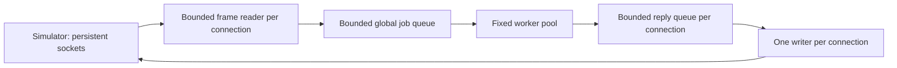

# FleetLab

FleetLab is a small Go portfolio project for exploring fleet telemetry, TCP connections, concurrency, and backpressure. A separate simulator sends synthetic vehicle telemetry over persistent TCP connections. The server validates each newline-delimited JSON message, submits it to a bounded queue, and processes it with a fixed worker pool. An acknowledgment means that the in-memory processing step completed.

The first slice is deliberately small: no database, Kafka, Kubernetes, external Go dependencies, or UI. It is a learning scaffold, with a real end-to-end path and tests for its concurrency and protocol boundaries. Metrics and screenshots below are placeholders until captured on real hardware.

## Run locally

Use Go 1.22 or newer and `make`. Prefer a currently supported Go release. The scaffold was validated with Go 1.27.2 on macOS ARM64; the exact official archive installation commands are in [the macOS setup record](docs/install-macos.md). No dependency download is needed. `GOTOOLCHAIN=local` prevents Go from fetching another toolchain automatically.

From the project directory:

```sh
GOTOOLCHAIN=local make fmt
GOTOOLCHAIN=local make check
make build
```

In one terminal:

```sh
./bin/server -addr 127.0.0.1:19000 -workers 4 -queue 256
```

In another:

```sh
./bin/simulator -addr 127.0.0.1:19000 -connections 100 -messages 10 -interval 10ms
```

The examples use port 19000; set the same address in both commands. The simulator prints a JSON summary and exits with a nonzero status on failure. Its throughput includes connection setup, pacing, processing, and acknowledgment time; it is not an isolated server capacity measurement. It opens all successful connections before starting messages, then sends one message at a time on each socket. Different sockets operate concurrently. There are no automatic reconnects or retries.

Stop the server with Ctrl-C or SIGTERM. It closes the listener and active sockets, cancels queued/in-flight work, waits for its goroutines, and prints counters. Shutdown cancels rather than drains outstanding messages. Keep connections open until expected acknowledgments arrive; disconnecting or half-closing the sending side cancels outstanding work for that connection.

## Wire format

Each frame is one JSON object followed by a newline. Example input (illustrative, not a captured run):

```json
{"id":"vehicle-1-1","vehicle_id":"vehicle-1","sent_at":"2026-01-01T00:00:00Z","speed_kph":40,"latitude":51.5,"longitude":-0.12}
```

A successful acknowledgment has the same `id`, `status: "processed"`, and a nonzero `processed_at` timestamp. A processor failure returns `status: "error"` with a generic error. Invalid JSON, unknown fields, invalid values, oversized frames, and missing final newlines close the connection. There is no retry, deduplication, durable delivery, authentication, or TLS in this local prototype. It binds to loopback by default; use synthetic data.

Workers can finish pipelined messages out of order. Replies are complete JSON lines from a single writer per connection; correlate them by ID. The bundled simulator avoids reordering by keeping only one outstanding message per connection.

## Shape of the project

```text
cmd/server/           TCP server executable
cmd/simulator/        separate load generator executable
internal/protocol/    message schema, validation, bounded framing
internal/server/      connection lifecycle, limits, serialized replies
internal/pipeline/    bounded queue and fixed worker pool
internal/processing/  initial in-memory validation step
internal/simulator/   persistent clients and run summary
internal/metrics/     atomic process-local counters
tests/integration/    real socket tests and opt-in connection scale tests
docs/                 architecture, validation status, future screenshots
benchmarks/           measurement procedure and unfilled results
```



When the work queue fills, a reader waits before reading more TCP data. TCP flow control eventually slows the sender. Reply queues are also bounded; slow readers can occupy workers until write deadlines close their connection. This demonstrates backpressure, with a documented fairness limitation rather than an unlimited buffer. See [architecture notes](docs/architecture.md).

## Concurrency and measurement

Concurrency lets many connections make progress while others wait for I/O. It does not mean one CPU core per connection. CPU parallelism is limited by available cores and `GOMAXPROCS`; worker count and useful CPU work determine how much processing can run at once. This initial validation-only processor is intentionally light and does not model a production enrichment workload.

Start with **100 real connections**, then try **1,000** only if file descriptor limits and hardware allow. **10,000** is exploratory, requires explicit opt-in and a raised application connection limit, and may fail on this Mac. Check existing limits with `ulimit -n`; a same-process integration test needs roughly two descriptors per connection, plus overhead. No limit or security settings are changed by this project.

```sh
# Default suite includes 100 real TCP connections.
go test ./...
go test -race ./...

# Opt-in correctness checks; not benchmark results.
FLEETLAB_CONNECTIONS=1000 go test ./tests/integration -run '^TestConnectionScale$' -count=1 -timeout=2m
FLEETLAB_CONNECTIONS=10000 go test ./tests/integration -run '^TestConnectionScale$' -count=1 -timeout=2m

# Separate processes for a 1,000-connection experiment:
./bin/server -max-connections 2000 -workers 4 -queue 256
./bin/simulator -connections 1000 -messages 100 -interval 10ms -timeout 30s
```

For 10,000, explicitly start the server with `-max-connections 12000 -read-timeout 90s`, then use the simulator's `-connections 10000 -timeout 60s`. Feasibility depends on actual hardware and OS limits. The simulator consumes CPU, memory, sockets, and scheduler time too. Running both on one Mac creates resource contention; it cannot establish isolated server capacity. Record both processes and repeat on separate machines before making broader claims. Race-enabled runs add overhead and are correctness checks, not performance measurements.

| Measurement | Result |
| --- | --- |
| Hardware / OS / Go version | TBD |
| Workload / connection count / duration | TBD |
| Throughput (acknowledged messages/s) | TBD |
| End-to-end p95 / p99 latency | TBD |
| Server and generator CPU / memory | TBD |
| Errors / disconnects | TBD |
| Workers / queue capacity / acknowledgment capacity | TBD |

The current simulator reports completion counts, failed connections, elapsed seconds, and acknowledged throughput. Latency quantiles, CPU/memory sampling, queue occupancy, and a dashboard are deferred. Do not infer them from the current summary. Use the [benchmark procedure and results template](benchmarks/README.md), including [race and profiling guidance](docs/architecture.md#verification-and-profiling).

## Screenshots and next steps

[Screenshot placeholders](docs/screenshots/README.md) describe future captures. There are no fabricated screenshot images or measured performance claims. Next useful steps are latency instrumentation, a representative processing workload, and a small read-only visualization after measurements exist. Persistence, distributed brokers, container orchestration, durability, retries, and multi-tenant security remain out of scope.

Verification results and their limits are recorded in [docs/validation.md](docs/validation.md). No license has been selected; ask the owner before adding one.
